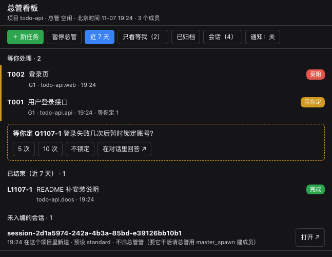
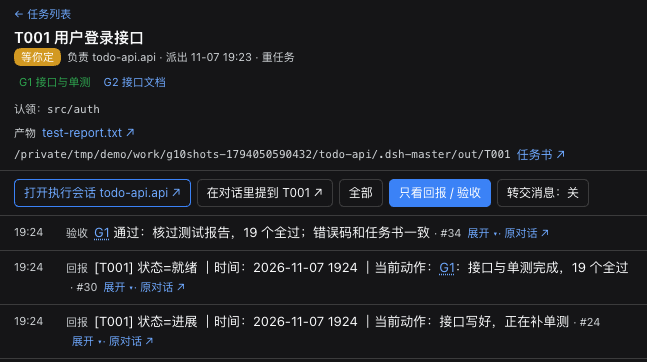

# dsh-master

[English](README.md) · **中文**

**给 DeepSeek Harness 配一个「项目总管」。** 在一个项目文件夹里，用「dsh-master 总管」预设新建会话，这个会话就成了这个项目的**总管**。它的工作是：
- 把你的要求拆成任务，派给**执行会话**；
- 收它们的结构化回报；
- 每到一道**闸门**就停下，核对过产物才往下走。

它就是一个普通的 DSH 插件组合包：不需要外部服务，不连云，状态都放在你自己的机器上。



> 现状：早期版本（0.2.x）。在 macOS + DSH `0.2.1-rc.5` 上开发、日常使用；全套测试在 DSH `0.2.2-rc.1`（Node 24）上也通过。0.2.2 起也能在 DeepSeek Harness 官方桌面端里用（在桌面端 `0.2.2-rc.5` 上测过）。0.2.3 起支持 Windows（在 Windows 11 + DSH `0.2.2-rc.5` 上测过，`dsh web` 和桌面端都测了）。DSH 0.2.2 默认关掉了宿主「写之前先读」的文件防护，见[环境要求](#环境要求)。界面、角色守则和工具说明都是中文，时间统一显示北京时间（UTC+8）。

## 为什么做它

单个 DSH 会话做单个任务已经很好用。可一旦几件事并行，你就成了调度员：
- 在会话之间来回切；
- 记着谁在做什么；
- 翻日志看有没有谁卡住了。

dsh-master 把这些记账的活交给插件：

- **一个项目一个总管。** 总管负责跟你说话、做协调；执行会话各自在独立上下文里干活，回报给总管，不直接找你。
- **闸门验收，不是一句「做完了」就算完。** 重任务先写任务书，里面有验收标准。执行会话到了闸门回报「就绪」并停下；总管自己去看产物，记一笔通过或打回。
- **真的会被翻出来的记忆。** 每次改动记一条带标签的 devlog。执行会话要动以前碰过的文件或话题时，插件会先把相关的旧条目推到它面前。
- **一眼能看完的看板。** 用的是 DSH 原生的右侧栏，能看到等你处理的、进行中的、已结束的。每个任务都能展开时间线、产物和问答。手机经 dsh-pocket 也能看。

## 功能

| | |
|---|---|
| **项目制总管** | 用「dsh-master 总管」预设在某个目录新建会话，这个目录就登记成项目。每个项目有自己的总管、成员、数据库、任务书、手册和 devlog。总管的预设不带 write / edit 工具：它派活、验收，不自己改文件。 |
| **结构化派活与回报** | 总管用 `master_dispatch`、`master_send`、`master_spawn`、`master_close`；成员用 `master_report` 回报，状态只有六种：进展、等待、受阻、失败、就绪、完成。消息由插件以自己的来源直接投给目标 Agent，不冒充用户；会去重、会退避重试，没投出去的重启后接着投。 |
| **闸门与验收** | 重任务必须先写任务书（`task_spec_write`），写明目标、交付物、验收标准、红线、预计耗时。闸门显示在看板上；`master_review` 把通过或打回记进时间线。 |
| **在看板上问你** | 成员不能直接打断你。需要你拍板的事，由总管用 `master_ask_user` 代问：看板上出现一张「等你定」卡片，点选项就是回答，答案再转给成员。 |
| **devlog 记忆** | 每个项目有自己的开发日志、决策日志和记忆，工具是 `devlog_add`、`devlog_recall`、`decision_add`、`memory_write`。按标签回忆（标签按 IDF 加权）；要写相关文件、或这一步提到相关话题之前，插件会自动推送前情。 |
| **守卫** | 模型不能直接写插件的状态，只能通过工具改。共用项目根的成员不能 `git add / commit / push`，由总管验收后统一提交。总管派活时可以给任务「认领」目录或文件，成员写进别人的认领范围会被拦下。实例日志目录只有总管能读。 |
| **巡检与定时保底** | 插件每 10 分钟巡检一次，查停滞、单轮过长、投递失败、没答的问题；只在发现跟上次报过的不一样时，才告诉总管。宿主里还有一条每 6 小时的定时保底；没有新发现的那一次直接跳过，不调模型。 |
| **暂停 / 恢复** | 看板上一个按钮。暂停时删掉这个项目的定时保底；巡检只做备份；成员一轮结束没回报也不提醒总管。你直接找总管照常能干活。 |
| **重活排队** | `heavy_run` 把渲染、转写、本地推理这类重活排队：先看可用内存，同一时间只跑一件，跑完通知发起的会话。 |
| **原生看板** | 右侧栏：列表、任务详情、时间线、产物预览、「等你定」和「等你点」横幅；输入框里能 `@任务`；每一轮对话会自动归到对应的任务。 |
| **直接找成员**（0.2.0） | 你可以在成员自己的会话里直接跟它说话，不叫醒总管：你开的那一轮不触发「没回报」提醒；在看板上回答「等你定」卡片，答案直接交给负责的成员，总管只收一条记录；成员改了结论、或者遇到要总管拍板的事，巡检会告诉总管。写 `directToMember: false` 回到旧行为。 |
| **总管状态栏**（0.2.0） | 看板顶上显示总管正在做什么（工具名加模型写的一句说明，不显示命令全文）、下次定时保底的时间，以及三个可点的计数：等你定、等你点、受阻。在岗的成员和它们手上没结的任务也列在这里。 |
| **Focus 区与按日期分组**（0.2.0） | 给任务点 ☆ 就置顶到「★ Focus」组。默认列表按日期分组显示最近 5 天，更早的折叠起来，每组都能收起 / 展开。 |
| **重活排队更聪明**（0.2.1） | 排在最前面的活要的可用内存不够时，后面要得少的先跑。`heavy_cancel` 取消排队中的活，`heavy_status` 看队列和插件读到的可用内存。门槛高于整机内存的直接拒，高于当前可用的当场提示；排了 15 分钟还够不着，巡检告诉总管。 |
| **跟进提醒**（0.2.1） | `master_remind`（「2026-11-28 10:00」「3h」「2d」）把提醒存进项目库，到点叫醒总管、带上原话；DSH 没开时错过的，下次补发并写明晚了多久。状态栏显示下一个提醒。 |
| **看板：搜索、收起、归档、你自己的叫法**（0.2.1） | 按编号、标题、负责人、最后一句回报搜任务，按状态和负责人筛。任何任务都能收起，已结束的能马上归档（5 秒内可撤销）。给任务起个你好记的叫法，总管和成员会收到说明，之后插件发的消息里编号后面都带着这个叫法。 |
| **支持 Windows**（0.2.3） | Windows 上 DSH 给模型的是 PowerShell 工具，不是 bash。重活排队改成用 PowerShell 跑（0.2.2 在 Windows 上一律失败）；状态目录守卫认得 PowerShell：命令一碰到状态目录，只放行只读命令。守卫也认工具的 `workdir` 参数；`heavy_run` 按调用者的角色检查（成员不能借它提交 git、读实例日志）。在真 Windows 11 上测过，CI 里 Windows、macOS、Linux 三个系统都跑。见 [Windows](#windows)。 |
| **凭据守卫**（0.2.4） | 任何会话（成员、总管、子代理、profile 里的普通会话）都不能读写 DSH 的凭据文件（`$DSH_HOME/.credentials.yaml` 存着模型 key 和网页登录 cookie 的签名密钥；还有 `.env`、`liveshare/`）。`read` / `grep` 工具、bash、PowerShell、通配符、对 `$DSH_HOME` 的递归读都拦。只是减速带，不是隔离，见[已知问题](#已知问题)。 |
| **官方桌面端能用了**（0.2.2） | 0.2.1 在官方桌面端里，看板能看，但点任何按钮（答「等你定」、暂停、收起、归档……）都报「origin 不是本服务」：桌面端转发请求时会去掉来源标记，插件把这种请求全拒了。0.2.2 起，没带来源标记的请求只要带着看板自己加的请求头、是 JSON，就放行；带了来源标记的仍然必须同源。另外，从 0.2.2 起，在插件页停用再启用、或者卸载后装新版，不用重启宿主，开着的总管 / 成员会话照常跑（0.2.1 会每一轮报 `database is not open`，要重启才好；所以从 0.2.1 升上来的这一次，装好后还要重启一次）。 |
| **总管更安静、更靠谱**（0.2.1） | 巡检发现只是有项消失时不再叫醒总管。已结案任务上的「等你定」答了，交给总管并叫醒它；结案后的迟到回报巡检会报。「等你定」挂超过 2 小时状态栏标红。压缩以后，总管 / 成员直接收到在途任务、没答的问题和手册「标准做法」原文。成员回报正文太长时只给总管看前一段（全文照存）。在对话里答过的「等你定」，总管用 `master_ask_close` 结案。 |

## 环境要求

- DeepSeek Harness 的 **`dsh web`** 或**官方桌面端**，版本 `>=0.2.1-rc.5 <0.3.0-0`，也就是 0.2.1 和 0.2.2 两个系列。这个范围写在 `engines.dsh` 里，超出范围 DSH 会拒绝安装和加载。在 `0.2.1-rc.5`、`0.2.2-rc.1`、`0.2.2-rc.4` 上测过，桌面端在 `0.2.2-rc.5` 上测过。0.2.2 上已知：在宿主的提问卡片上答完以后，看板「等你点」的提醒有时会晚一点才消失（插件只负责提醒，答案由 DSH 自己处理）；0.2.0 也一样，在查。
- Node.js **>= 22.19**（用到内置的 `node:sqlite`）。DSH 0.2.2 本身要 Node >= 24.9。
- DSH 0.2.2 上，宿主「写之前先读」的文件防护（`dsh-base` 组合包里的 `fs-observation-policy`）**默认关**。关着的时候，两个成员同时改同一个文件，宿主不会拦下后写的，插件的「乐观锁冲突提示」也就不起作用；插件自己的「认领」（成员写进别的任务认领的范围会被拦下）不受影响。要这道防护，把 profile 里那一行改成 `disabled: false`。它对 profile 里的所有会话生效，所以插件不替你改。
- 平台：在 macOS 上开发；0.2.3 起也支持 Windows（在 Windows 11 上测过；见下面的 [Windows](#windows)）。Linux 只在 CI 里跑单测，还没配真 DSH 试过。
- 如果你在 DSH 前面自己架了反向代理：别让它删掉浏览器请求的 `Origin` 头，也别让它替 DSH 应答预检、回 CORS 头，否则看板写操作的防跨站检查会失效。

## 安装

> **装在哪里。** 同一个 `DSH_HOME` 下的各个 profile 共用会话列表、定时任务和模型凭据。装进日常用的 profile，总管和成员会话会和你的日常会话出现在一起（见下文「它会改动你的 DSH 什么」）。想隔开，就用单独的 `DSH_HOME` 起一个实例（方式 B）。

**从插件市场装（最省事）。** DSH 官方没有插件市场，社区插件 [dshmarket](https://github.com/dsh-market/dsh-market) 提供了一个。先装一次它：`dsh plugin --profile web add dshmarket`，然后重启 `dsh web`。再打开「插件」页的「插件市场」标签，搜 `ZhuFrank`，在 dsh-master 上点「安装」→「确认安装」，按提示刷新页面。市场的目录大约一天更新一次，新版本可能要过一天才出现在市场里；想马上装某个指定版本，用下面的方式 A。

**A. 装进日常 profile（`web`）。** 先停掉 `dsh web`，然后运行：

```sh
dsh plugin --profile web add https://github.com/ZhuFrank/dsh-master-plugin/releases/download/v0.2.4/dsh-master-0.2.4.tgz
```

再启动 `dsh web`，刷新网页。也可以从 npm 装：`dsh plugin --profile web add dsh-master`。

**官方桌面端。** 打开「插件」→「添加插件」，填 `dsh-master`（npm 上的包）或上面的 Release 地址，点「安装」→「立即启用」，不用重启。升级：桌面端要求先卸载旧版（点开插件详情，「卸载」），再照上面装新版。插件数据（任务、devlog、看板设置）在 `DSH_HOME/dsh-master`（默认 `~/.dsh/dsh-master`），卸载不会删。**从 0.2.1 升上来的这一次，装好后要重启一次桌面端**（0.2.1 卸载时留下的旧东西会让开着的总管会话每一轮报 `database is not open`）；0.2.2 以后再升级不用重启。

**B. 单独起一个实例**（自己的 `DSH_HOME`、自己的端口）：

```sh
export DSH_HOME=~/.dsh-master DSH_AGENTS_HOME=~/.dsh-master/agents-home
dsh --profile master --from-default-profile web --dump-config > /dev/null   # 第一次：建 profile
dsh plugin --profile master add https://github.com/ZhuFrank/dsh-master-plugin/releases/download/v0.2.4/dsh-master-0.2.4.tgz
dsh --profile master --port 3090                                            # 打开 http://127.0.0.1:3090
```

单独的实例要在它自己的「模型」设置页里填模型密钥。

**从源码装：**

```sh
git clone https://github.com/ZhuFrank/dsh-master-plugin && cd dsh-master-plugin
pnpm install && pnpm build
dsh plugin --profile web add link:$PWD/packages/dsh-master
```

### Windows

0.2.3 起支持 Windows。Windows 上 DSH 给模型的命令行工具是 PowerShell（`pwsh`），不是 `bash`。和 macOS 不一样的地方：

- **重活排队**（`heavy_run`）用 PowerShell 跑，选法和 DSH 一样（装了 PowerShell 7 用 7，否则用系统自带的 5.1），不弹窗口。命令照在 `pwsh` 工具里那样用 PowerShell 写，但重活是插件起的、不是 DSH 起的：不进 DSH 的沙盒，没有 DSH 的 `DSH_*` 环境变量，你给 DSH 配的 `pwshPath` 也不跟。日志里 PowerShell 自己的输出是 UTF-8（日志开头有 BOM），原生程序直接写日志，可能是系统代码页。用 `read` 工具读；在 PowerShell 5.1 里读要加 `-Encoding UTF8`。程序都没起来时，原因写在日志和「重活结束」的消息里。
- **状态目录守卫**认得 PowerShell：命令一碰到插件的状态目录（`$DSH_HOME\dsh-master`、`<项目>\.dsh-master`），只放行只读命令（`Get-Content`、`ls`、`Select-String`、`Test-Path`、只读的 `git` 等），常见的写法（`Set-Content`、`Remove-Item`、`> 文件`、.NET 写法、方法调用、给属性赋值、`iex`、脚本等）都会拦下，提示改用 `read` 工具。不分大小写，认得 `$env:X`、`Join-Path`、`-Path:值`、`\\?\` 路径、通配符和前面的 `cd`。命令里连目录名都没出现、运行时才拼出来的路径看不出来，靠带外改动检测兜底（见[已知问题](#已知问题)）。
- 实际装过一遍（Windows 11、DSH 0.2.2-rc.5）的注意事项：
  - PowerShell 可能拒绝运行 `npm` / `dsh`（「禁止运行脚本」）：改用 `npm.cmd` / `dsh.cmd`，或者 `Set-ExecutionPolicy -Scope CurrentUser RemoteSigned`。
  - npm 11 默认不跑依赖的安装脚本：装 DSH 用 `npm i -g @deepseek-ai/dsh --allow-scripts=@deepseek-ai/dsh-subprocess-local,koffi,node-pty,@google/genai,protobufjs`。
  - `dsh plugin` 要用 `pnpm`（`npm i -g pnpm`），npm 装的 DSH 不带。
  - 装完 Node、设好 `DSH_HOME` 之后要开一个新终端，旧终端里还是旧的 `PATH` / 环境变量。
  - 工作目录用自己的账号（非管理员）建。所有者是 Administrators 的目录，DSH 沙盒加不上权限，`pwsh` 命令全会失败。
  - `dsh web` 和桌面端可以共用一个 `DSH_HOME`（模型 key 共用），但插件状态目录也是共用的：两边别同时开，后开的那个插件起不来。
  - 桌面端装下载好的 `.tgz`：在「插件 → 添加插件」里填文件路径（比如 `E:\Downloads\dsh-master-0.2.4.tgz`）；命令行改不了桌面端的配置，会被拒绝。
- 守卫按命令里写出来的东西判断：命令里只要提到状态目录（比如提交说明或字符串里写了 `.dsh-master`），又带着不是只读的命令，也会被拦。换个说法，或者改用 `read` / dsh-master 工具。

## 快速上手

1. **开张**：点「新会话」，选项目所在的文件夹，Agent 预设选「dsh-master 总管」。选好就开张，不用先发消息：这个文件夹成了项目，这个会话就是它的总管（总管会自己先跑一轮，读开张通知）。
2. **派活**：直接跟总管说要做什么。它会判断轻重；重任务先写任务书，再建成员（`master_spawn`）、派活。
3. **看进度**：打开「总管看板」，左侧栏和会话标题栏上都有入口。「等你处理」里的卡片要你来动手：回答问题，或者去那个会话里点批准。
4. **过闸门**：成员到了闸门，总管核对产物、记下验收。往下做不做，由你决定。



## 配置

写在 profile 的 `cordis.patch.yml` 里：

```yaml
- id: dsh-master
  config:
    projectMasterPreset: workspace-write   # 默认；写 danger-full-access 让总管能往项目外写
    projectMemberPreset: workspace-write   # 默认
    scheduleEverySeconds: 21600            # 定时保底间隔；0 关闭
    secretPaths: []                        # 默认 [$DSH_HOME/logs]：只有总管能读的目录
    credentialPaths: []                    # 再加几个谁都不能读的凭据文件 / 目录（下面那几个默认的总是在）
```

| 配置 | 默认值 | 含义 |
|---|---|---|
| `projectMasterPreset` | `workspace-write` | 每次启动时给项目总管设的权限预设。 |
| `projectMemberPreset` | `workspace-write` | 成员的权限预设：只能写项目根里面。 |
| `scheduleEverySeconds` | `21600` | 每个总管的定时保底间隔；`0` 关闭。 |
| `patrol.intervalMs` | `600000` | 插件内巡检的间隔。 |
| `idleGraceMs` | `120000` | 成员一轮结束、没回报，过多久提醒总管。 |
| `directToMember` | `true` | 允许直接找成员（见「直接找成员」）。写 `false` 回到 0.1.x 的做法：你的每一轮话和看板上的回答都经总管。 |
| `secretPaths` | `[$DSH_HOME/logs]` | 非总管会话不能读的目录（dsh.log 里有登录令牌）。 |
| `credentialPaths` | `[]` | 再加几个**任何会话**都不能读写的凭据文件或目录，总管也不行。`$DSH_HOME/.credentials.yaml`（模型 key 和网页登录 cookie 的签名密钥）、`$DSH_HOME/.env`、`$DSH_HOME/liveshare/` 总是在名单里；改过凭据文件位置的，把新位置加进来。 |
| `stateDir` | `$DSH_HOME/dsh-master` | 插件状态目录：SQLite 数据库、文档、备份。 |
| `legacy` | 自动 | 不分项目、全局只有一个总管的早期形态。新装默认 `off`；只有想要一个不绑项目的全局总管时，才写 `active`。 |
| `autoRecall` | `{ byFile: true, byTopic: true }` | 写文件前、每一步开始前自动推送 devlog 前情。 |

## 它会改动你的 DSH 什么

装之前先看清楚它会碰哪些东西：

- **两个 Agent 预设**：「dsh-master 总管」和「dsh-master 执行会话」。后者由插件自己用，不供手动选择。
- **会话**：总管和成员都是普通的 DSH 会话，会出现在侧栏里。不属于任何项目的会话，不会多出工具、守则或提醒。
- **守卫对 profile 里的每个会话生效**，但项目以外的会话只受三条约束：
  - 不能读 `secretPaths`；
  - 不能读写 DSH 的凭据文件：`$DSH_HOME/.credentials.yaml`、`$DSH_HOME/.env`、`$DSH_HOME/liveshare/` 和 `credentialPaths`。这一条对所有会话都生效，总管和子代理也一样。让会话帮你看模型 key 会被拒绝，请到「设置 → 模型」里看；
  - 不能直接写插件的状态目录，也就是 `$DSH_HOME/dsh-master` 和 `<项目根>/.dsh-master/`（`out/` 除外）。

  其他规则只对总管和成员生效。
- **定时任务**：每个项目总管在「自动化任务」里有一条「dsh-master 定时巡检保底」。
- **文件**：只有插件的状态目录，和每个项目根下的 `.dsh-master/`（任务书、手册、devlog、产物）。别的地方都不碰。

## 卸载

`dsh web` 运行时，在「插件」页卸载，或运行 `dsh plugin --profile web remove dsh-master`，然后重启。profile 一旦不再选中插件，它会删掉自己建的定时保底。

如果是在 DSH 停着的时候卸载的，请到「自动化任务」里手动删掉「dsh-master 定时巡检保底」。

卸载后会话、`$DSH_HOME/dsh-master` 和 `<项目根>/.dsh-master/` 都还留着，不需要了再自己删。

## 已知问题

- **DSH 里所有 `git` 命令都报 `missing config key GIT_CONFIG_KEY_0`、退出码 128。** 原因是启动 `dsh web` 的环境里带着 `GIT_CONFIG_COUNT` / `GIT_CONFIG_KEY_n` / `GIT_CONFIG_VALUE_n`：DSH 的 bash 沙盒会去掉 `GIT_CONFIG_KEY_*`，却把另外两个传了进去。这不是本插件引起的。绕法：启动 DSH 前先 `unset GIT_CONFIG_COUNT`（或用 `env -u GIT_CONFIG_COUNT dsh web …` 启动）。
- **状态目录守卫只看得到命令里写出来的东西。** 命令里看得出要往插件状态目录里写的（bash 和 PowerShell 都算，也认 `workdir` 参数）会被拦；但运行时用变量拼出来的路径、bash 里先 `cd` 进去再写相对路径、自己写文件的脚本、8.3 短文件名、目录联接 / 符号链接、`subst` 映射的盘符、WSL 的 `/mnt/…` 路径、删掉**上级**目录，都看不出来。兜底是带外改动检测：插件下次写自己的文档时发现被改过，把外面的版本另存到 `drift-copies/`，巡检会报出来。删掉的文件、被改的 `master.db` / `memory.db` 救不回来。

- **凭据守卫只是减速带，不是隔离。** 从 0.2.4 起，用 `read` / `grep` 工具、bash、PowerShell 读写 `$DSH_HOME/.credentials.yaml`、`$DSH_HOME/.env`、`$DSH_HOME/liveshare/` 会被拦：绝对路径，`$DSH_HOME` / `$env:DSH_HOME` / `~` 写法，先 `cd` 或用 `workdir` 再写相对路径，通配符（`$DSH_HOME/.cred*`、`$DSH_HOME/*`），`Join-Path`，以及对 `$DSH_HOME` 本身的递归读（`grep -r`、`rg`、`tar`、`cp -r`、`find -exec`、`Select-String`、`Compress-Archive` 等）。成员开的子代理也走同一个守卫（在 DSH 0.2.1-rc.5 和 0.2.2-rc.4 上测过）。看不出来的：脚本自己打开文件（`python x.py`）、运行时拼出来或编码过的路径、对 `$DSH_HOME` **上级**目录的递归读（比如 `grep -r sk- ~`）、其他插件或 MCP 的读文件工具里参数名不常见的。DeepSeek 自己的文档也写明：本地凭据文件挡不住 agent，因为工具进程和你是同一个系统用户；要真正隔离，请让 DSH 用单独的系统用户运行。0.2.4 以前的版本完全不拦这些文件。

## 和 DeepSeek Super-agent 设计的关系

DeepSeek Harness 团队发表过《Super-agent 设计探索》（2026 年 10 月），同时开源了 [dsh-superagent-prototype](https://github.com/deepseek-ai/dsh-superagent-prototype)。dsh-master 是 Super-agent 设计的**个人单机版实现**：一个人、一台电脑，以插件形式跑在本地 DSH 里；云端存状态、群聊 / GitHub / 邮件触发、远程执行都没做（见下文）。本项目是个人作品，与 DeepSeek 官方无关。和原设计对得上的地方有这几处：

- **双层架构。** 文章把系统分成两层：常驻的一层负责跟人交互、分派任务；上下文隔离的执行会话负责干活并汇报。在 dsh-master 里，项目总管就是负责协调的那一层，它的预设不带 write / edit；成员在各自的上下文里干活，回报给总管。我们的两个预设就是照原型的 router / worker 预设改的（MIT）。
- **由插件投递消息。** 照原型的做法，跨会话消息由插件以自己的来源直接投给 Agent，不经过用户的输入框。
- **定时消息驱动的 Watchdog。** 文章用定时消息驱动一个独立会话，判断各个 Worker 有没有实质进展。dsh-master 的巡检和定时保底在每个项目里做这件事；没有变化时保持安静。
- **人上移到决策与验收。** 闸门、验收、「等你定」，就是 dsh-master 给人留的位置。

dsh-master **不做**的：IM / GitHub / 邮件触发、云端托管状态、远程执行 daemon。它只在一个本地 DSH 实例里运行。

## 开发

```sh
pnpm install
pnpm check          # 类型检查 + 单测 + 构建 + 端到端
node scripts/mutate.mjs --only <编号>   # 反向验证：改坏一行，点名的测试必须变红
```

端到端测试在 `~/dsh-master-e2e` 下起一个临时的 DSH 实例（用假模型）和一个无头 Chrome。可以用 `DSH_E2E_ROOT` 换目录。它不会碰你真正的 `~/.dsh`。

## 许可证

[MIT](LICENSE)。`packages/dsh-master/cordis.patch.yml` 里的两个 Agent 预设改自 [deepseek-ai/dsh-superagent-prototype](https://github.com/deepseek-ai/dsh-superagent-prototype)（MIT）。
