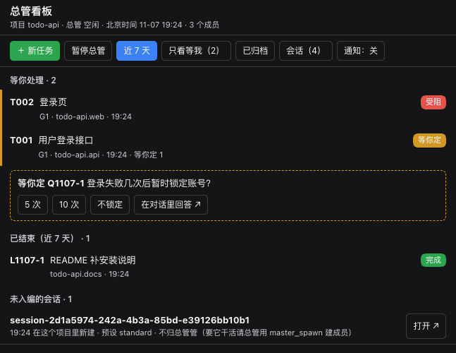
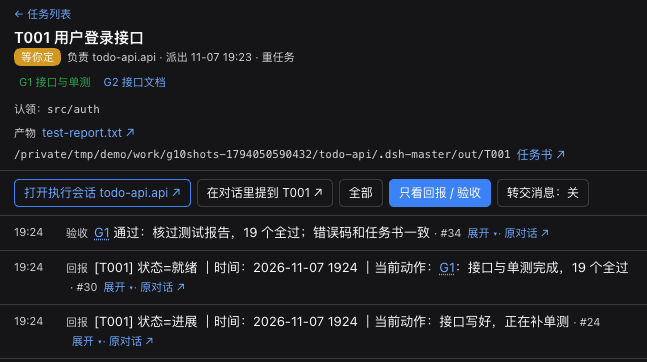

# dsh-master

**English** · [中文](https://github.com/ZhuFrank/dsh-master-plugin/blob/main/README.zh-CN.md)

**A project lead for DeepSeek Harness.** Open a session in a project folder with the *dsh-master 总管* preset, and that session becomes the folder's **master**. It breaks your requests into tasks, hands them to **member sessions**, collects their structured reports, and stops at every **gate** until the work has been checked. It runs as a plain DSH plugin bundle. There is no external service and no cloud component, and its state lives on your own machine.



> Status: early (0.1.x). Developed and used daily on macOS with DSH `0.2.1-rc.5`. DSH 0.2.2 changed the schedule API and turned off the file-observation guard by default, so 0.2.2 is not supported yet. The UI, the role prompts and the tool descriptions are in Chinese, and timestamps are shown in China Standard Time (UTC+8).

## Why

A single DSH session works well for a single task. Once you have several streams of work going in parallel, you become the scheduler: you switch sessions, remember who was doing what, re-read logs to see whether anything stalled, and keep it all in your head. dsh-master moves that bookkeeping into the plugin:

- **One master per project.** The master talks to you and coordinates. Members do the work, each in its own context, and report back to the master rather than to you.
- **Gates instead of "trust me, it's done".** Heavy tasks get a written task spec with acceptance criteria. A member that reaches a gate reports *ready* and stops. The master reviews the products itself, and records a pass or a send-back.
- **Memory that is actually consulted.** Every change gets a devlog entry with tags. Before a member touches a file or topic that has history, the plugin pushes the relevant past entries into its context.
- **A board you can glance at.** It is a native DSH side panel: what needs you, what is in progress, what finished. You can open every task's timeline, products and Q&A. It also works on a phone through dsh-pocket.

## Features

| | |
|---|---|
| **Project-based masters** | Starting a session with the *dsh-master 总管* preset in a folder registers that folder as a project. Each project has its own master, members, database, task specs, handbooks and devlog. The master's preset has no write/edit tools: it dispatches and reviews, and leaves the editing to members. |
| **Structured dispatch & reports** | `master_dispatch`, `master_send`, `master_spawn` and `master_close` handle the master's side; `master_report` (progress / waiting / blocked / failed / ready / done) handles the member's. Messages go straight to the target agent under the plugin's own message source. They never pose as user messages. They are de-duplicated and retried with backoff, and pending deliveries survive a restart. |
| **Gates & reviews** | Heavy tasks need a task spec first (`task_spec_write`): goal, deliverables, acceptance criteria, red lines, expected duration. Gates appear on the board, and `master_review` records each pass or send-back on the timeline. |
| **Ask the user, on the board** | Members cannot interrupt you. When a decision is yours, the master asks through `master_ask_user`. The question shows up as a "needs you" card with clickable options, and your answer is relayed back. |
| **Devlog memory** | `devlog_add` / `devlog_recall` / `decision_add` / `memory_write` keep a tagged development log, a decision log and memories per project. Recall matches on tags (weighted by IDF), and relevant entries are pushed automatically before a step touches related files or topics. |
| **Guards** | Agents cannot write the plugin's state directly, only through its tools. Members cannot `git add/commit/push` in a shared project root; the master commits after review. When dispatching, the master can claim files and directories for a task; a member writing into another task's claim is blocked. Only the master can read the instance log directory. |
| **Patrol & safety-net schedule** | Every 10 minutes the plugin checks for stalls, overlong turns, failed deliveries and unanswered questions, and tells the master only when the set of findings changes. A host schedule (every 6 h) is the safety net. When nothing new turned up, the plugin skips that run without calling the model. |
| **Pause / resume** | One button on the board. While paused, the project's schedule is removed, patrol only takes backups, and members finishing a turn without reporting no longer trigger reminders. Talking to the master directly still works. |
| **Heavy-job queue** | `heavy_run` queues renders, transcriptions or local inference behind a free-memory check, one job at a time, and notifies the session when the job finishes. |
| **Native board** | A right-side panel with lists, task detail, timeline, products preview, "needs you" and "waiting for your click" banners, and `@task` mentions in the composer. Your turns are attributed to tasks automatically. |

## Requirements

- DeepSeek Harness **`dsh web`**, version `>=0.2.1-rc.5 <0.2.2-0`, i.e. the 0.2.1 line (declared in `engines.dsh`; DSH refuses to install or load it outside this range, including 0.2.2 pre-releases).
- Node.js **>= 22.19** (the plugin uses the built-in `node:sqlite`).
- macOS is the only platform tested so far.

## Install

> **Where to install.** All profiles under one `DSH_HOME` share the session list, schedules and model credentials. If you install into your everyday profile, the master and member sessions appear next to your everyday sessions (see [What it changes](#what-it-changes-in-your-dsh)). To keep them apart, run a separate instance with its own `DSH_HOME` (option B).

**A. Into your everyday profile (`web`).** Stop `dsh web`, then:

```sh
dsh plugin --profile web add https://github.com/ZhuFrank/dsh-master-plugin/releases/download/v0.1.0/dsh-master-0.1.0.tgz
```

Start `dsh web` again and reload the page.

**B. A separate instance** (own `DSH_HOME`, own port):

```sh
export DSH_HOME=~/.dsh-master DSH_AGENTS_HOME=~/.dsh-master/agents-home
dsh --profile master --from-default-profile web --dump-config > /dev/null   # create the profile once
dsh plugin --profile master add https://github.com/ZhuFrank/dsh-master-plugin/releases/download/v0.1.0/dsh-master-0.1.0.tgz
dsh --profile master --port 3090                                            # then open http://127.0.0.1:3090
```

In a separate instance, add a model key on its own *Models* settings page.

**From source:**

```sh
git clone https://github.com/ZhuFrank/dsh-master-plugin && cd dsh-master-plugin
pnpm install && pnpm build
dsh plugin --profile web add link:$PWD/packages/dsh-master
```

## Quick start

1. Click **New session**, pick your project folder, and choose the **dsh-master 总管** agent preset. Send it a first message: the folder is now a project, and this session is its master.
2. Tell the master what you want done. It decides whether the work is heavy or light, writes a task spec for heavy work, creates members (`master_spawn`) and dispatches.
3. Open **总管看板** (the "master board"), either from the left sidebar or from the session header, to follow along. Cards under **等你处理** need you: answer the question, or open the session that is waiting for an approval.
4. When a member reaches a gate, the master checks the products and records the review. You decide whether to continue.



## Configuration

Settings go in your profile's `cordis.patch.yml`:

```yaml
- id: dsh-master
  config:
    projectMasterPreset: workspace-write   # default; use danger-full-access to let masters write outside the project
    projectMemberPreset: workspace-write   # default
    scheduleEverySeconds: 21600            # safety-net schedule; 0 turns it off
    secretPaths: []                        # default [$DSH_HOME/logs]; directories only the master may read
```

| Key | Default | Meaning |
|---|---|---|
| `projectMasterPreset` | `workspace-write` | Permission preset applied to every project master at startup. |
| `projectMemberPreset` | `workspace-write` | Permission preset for members: they can write inside the project root only. |
| `scheduleEverySeconds` | `21600` | Interval of the safety-net host schedule for each master. `0` disables it. |
| `patrol.intervalMs` | `600000` | In-plugin patrol interval. |
| `idleGraceMs` | `120000` | How long after a member's turn ends without a report before the master is reminded. |
| `secretPaths` | `[$DSH_HOME/logs]` | Directories that non-master sessions may not read (the DSH log contains the login token). |
| `stateDir` | `$DSH_HOME/dsh-master` | Plugin state: SQLite databases, docs, backups. |
| `legacy` | auto | The pre-project "single master" mode. New installs leave it `off`; set `active` only if you want one global master that is not tied to a project. |
| `autoRecall` | `{ byFile: true, byTopic: true }` | Automatic devlog pushes before writes and before steps. |

## What it changes in your DSH

Before installing, you should know exactly what the plugin touches:

- **Two agent presets** appear in the preset list: *dsh-master 总管* (master) and *dsh-master 执行会话* (member, used by the plugin itself).
- **Sessions:** masters and members are ordinary DSH sessions, so they show up in the sidebar. Sessions that do not belong to a project get no extra tools, prompts or reminders.
- **Guard rules for every session in the profile:** only two rules apply to sessions outside a project. They cannot read `secretPaths`, and they cannot write the plugin's state directories (`$DSH_HOME/dsh-master`, `<project>/.dsh-master/` except `out/`). All other rules apply only to masters and members.
- **Schedules:** one *dsh-master 定时巡检保底* entry per project master in your Automations list.
- **Files:** the plugin's state directory and a `.dsh-master/` folder in each project root (task specs, handbooks, devlog, products). Nothing outside these places is touched.

## Uninstall

Remove the plugin from the **Plugins** page, or run `dsh plugin --profile web remove dsh-master` while `dsh web` is running, then restart. When the profile no longer selects the plugin, the plugin deletes the safety-net schedules it created. If you remove it while DSH is stopped, delete the *dsh-master 定时巡检保底* entries from Automations by hand. Your sessions, `$DSH_HOME/dsh-master` and `<project>/.dsh-master/` are left in place; delete them if you no longer need them.

## Known issues

- **Every `git` command inside DSH fails with `missing config key GIT_CONFIG_KEY_0` (exit 128).** This happens when the environment that starts `dsh web` contains `GIT_CONFIG_COUNT` / `GIT_CONFIG_KEY_n` / `GIT_CONFIG_VALUE_n`: DSH's bash sandbox drops the `GIT_CONFIG_KEY_*` variables but passes the other two. It is not caused by this plugin. Workaround: start DSH with `unset GIT_CONFIG_COUNT` (or `env -u GIT_CONFIG_COUNT dsh web …`).

## Relation to DeepSeek's Super-agent design

DeepSeek Harness's team published *Super-agent 设计探索* (Oct 2026) together with [dsh-superagent-prototype](https://github.com/deepseek-ai/dsh-superagent-prototype). dsh-master is a **local, plugin-level take on a few of those ideas**. It is not an implementation of Super-agent. Where the ideas meet:

- **Two layers.** The article separates a resident layer that talks to people and dispatches work from isolated worker sessions that execute and report back. In dsh-master, a project master is that coordinating layer. Its preset has no write/edit tools, and members run tasks in their own contexts and report to it. Our two presets were adapted from the prototype's router and worker presets (MIT).
- **Plugin-delivered messages.** Following the prototype, cross-session messages are delivered to the agent directly under the plugin's own source. They do not go through the user's input box.
- **A watchdog driven by timed messages.** The article runs a separate session on a timer to check whether workers make real progress. dsh-master's patrol and its safety-net schedule play that role for each project, and they stay silent when nothing changed.
- **People move up to decisions and acceptance.** Gates, reviews and *needs you* cards are where dsh-master puts the human.

What dsh-master does **not** do: IM, GitHub or e-mail triggers, cloud-hosted state, or remote execution daemons. It runs inside one local DSH instance.

## Development

```sh
pnpm install
pnpm check          # typecheck + unit tests + build + end-to-end tests
node scripts/mutate.mjs --only <id>   # mutation tests: break one line, the named test must go red
```

The end-to-end tests start a throw-away DSH instance with a mock model, plus a headless Chrome, under `~/dsh-master-e2e` (override with `DSH_E2E_ROOT`). They never touch your real `~/.dsh`.

## License

[MIT](https://github.com/ZhuFrank/dsh-master-plugin/blob/main/LICENSE). The two agent presets in `packages/dsh-master/cordis.patch.yml` are adapted from [deepseek-ai/dsh-superagent-prototype](https://github.com/deepseek-ai/dsh-superagent-prototype) (MIT).
