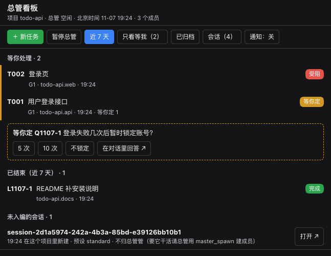
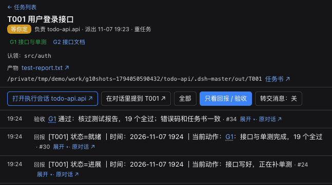

# dsh-master

[English](https://github.com/ZhuFrank/dsh-master-plugin/blob/main/README.md) · **中文**

**给 DeepSeek Harness 配一个「项目总管」。** 在一个项目文件夹里，用「dsh-master 总管」预设新建会话，这个会话就成了这个项目的**总管**。它的工作是：
- 把你的要求拆成任务，派给**执行会话**；
- 收它们的结构化回报；
- 每到一道**闸门**就停下，核对过产物才往下走。

它就是一个普通的 DSH 插件组合包：不需要外部服务，不连云，状态都放在你自己的机器上。



> 现状：早期版本（0.1.x）。在 macOS + DSH `0.2.1-rc.5` 上开发、日常使用。DSH 0.2.2 改了定时服务的接口，还默认关掉了「写之前先读」的文件防护，所以暂时不支持 0.2.2。界面、角色守则和工具说明都是中文，时间统一显示北京时间（UTC+8）。

## 为什么做它

单个 DSH 会话做单个任务已经很好用。可一旦几件事并行，你就成了调度员：
- 在会话之间来回切；
- 记着谁在做什么；
- 翻日志看有没有谁卡住了。

dsh-master 把这些记账的活交给插件：

- **一个项目一个总管。** 总管负责跟你说话、做协调；执行会话各自在独立上下文里干活，回报给总管，不直接找你。
- **闸门验收，不是一句「做完了」就算完。** 重任务先写任务书，里面有验收标准。执行会话到了闸门回报「就绪」并停下；总管自己去看产物，记一笔通过或打回。
- **真的会被翻出来的记忆。** 每次改动记一条带标签的 devlog。执行会话要动以前碰过的文件或话题时，插件会先把相关的旧条目推到它面前。
- **一眼能看完的看板。** 用的是 DSH 原生的右侧栏，能看到等你处理的、进行中的、已结束的。每个任务都能展开时间线、产物和问答。手机经 dsh-pocket 也能看。

## 功能

| | |
|---|---|
| **项目制总管** | 用「dsh-master 总管」预设在某个目录新建会话，这个目录就登记成项目。每个项目有自己的总管、成员、数据库、任务书、手册和 devlog。总管的预设不带 write / edit 工具：它派活、验收，不自己改文件。 |
| **结构化派活与回报** | 总管用 `master_dispatch`、`master_send`、`master_spawn`、`master_close`；成员用 `master_report` 回报，状态只有六种：进展、等待、受阻、失败、就绪、完成。消息由插件以自己的来源直接投给目标 Agent，不冒充用户；会去重、会退避重试，没投出去的重启后接着投。 |
| **闸门与验收** | 重任务必须先写任务书（`task_spec_write`），写明目标、交付物、验收标准、红线、预计耗时。闸门显示在看板上；`master_review` 把通过或打回记进时间线。 |
| **在看板上问你** | 成员不能直接打断你。需要你拍板的事，由总管用 `master_ask_user` 代问：看板上出现一张「等你定」卡片，点选项就是回答，答案再转给成员。 |
| **devlog 记忆** | 每个项目有自己的开发日志、决策日志和记忆，工具是 `devlog_add`、`devlog_recall`、`decision_add`、`memory_write`。按标签回忆（标签按 IDF 加权）；要写相关文件、或这一步提到相关话题之前，插件会自动推送前情。 |
| **守卫** | 模型不能直接写插件的状态，只能通过工具改。共用项目根的成员不能 `git add / commit / push`，由总管验收后统一提交。总管派活时可以给任务「认领」目录或文件，成员写进别人的认领范围会被拦下。实例日志目录只有总管能读。 |
| **巡检与定时保底** | 插件每 10 分钟巡检一次，查停滞、单轮过长、投递失败、没答的问题；只在发现跟上次报过的不一样时，才告诉总管。宿主里还有一条每 6 小时的定时保底；没有新发现的那一次直接跳过，不调模型。 |
| **暂停 / 恢复** | 看板上一个按钮。暂停时删掉这个项目的定时保底；巡检只做备份；成员一轮结束没回报也不提醒总管。你直接找总管照常能干活。 |
| **重活排队** | `heavy_run` 把渲染、转写、本地推理这类重活排队：先看可用内存，同一时间只跑一件，跑完通知发起的会话。 |
| **原生看板** | 右侧栏：列表、任务详情、时间线、产物预览、「等你定」和「等你点」横幅；输入框里能 `@任务`；每一轮对话会自动归到对应的任务。 |

## 环境要求

- DeepSeek Harness 的 **`dsh web`**，版本 `>=0.2.1-rc.5 <0.2.2-0`，也就是 0.2.1 这一系列。这个范围写在 `engines.dsh` 里，超出范围（包括 0.2.2 的预发布版）DSH 会拒绝安装和加载。
- Node.js **>= 22.19**（用到内置的 `node:sqlite`）。
- 目前只在 macOS 上测过。

## 安装

> **装在哪里。** 同一个 `DSH_HOME` 下的各个 profile 共用会话列表、定时任务和模型凭据。装进日常用的 profile，总管和成员会话会和你的日常会话出现在一起（见下文「它会改动你的 DSH 什么」）。想隔开，就用单独的 `DSH_HOME` 起一个实例（方式 B）。

**A. 装进日常 profile（`web`）。** 先停掉 `dsh web`，然后运行：

```sh
dsh plugin --profile web add https://github.com/ZhuFrank/dsh-master-plugin/releases/download/v0.1.0/dsh-master-0.1.0.tgz
```

再启动 `dsh web`，刷新网页。

**B. 单独起一个实例**（自己的 `DSH_HOME`、自己的端口）：

```sh
export DSH_HOME=~/.dsh-master DSH_AGENTS_HOME=~/.dsh-master/agents-home
dsh --profile master --from-default-profile web --dump-config > /dev/null   # 第一次：建 profile
dsh plugin --profile master add https://github.com/ZhuFrank/dsh-master-plugin/releases/download/v0.1.0/dsh-master-0.1.0.tgz
dsh --profile master --port 3090                                            # 打开 http://127.0.0.1:3090
```

单独的实例要在它自己的「模型」设置页里填模型密钥。

**从源码装：**

```sh
git clone https://github.com/ZhuFrank/dsh-master-plugin && cd dsh-master-plugin
pnpm install && pnpm build
dsh plugin --profile web add link:$PWD/packages/dsh-master
```

## 快速上手

1. **开张**：点「新会话」，选项目所在的文件夹，Agent 预设选「dsh-master 总管」，发第一句话。这个文件夹就开张成了项目，这个会话就是它的总管。
2. **派活**：直接跟总管说要做什么。它会判断轻重；重任务先写任务书，再建成员（`master_spawn`）、派活。
3. **看进度**：打开「总管看板」，左侧栏和会话标题栏上都有入口。「等你处理」里的卡片要你来动手：回答问题，或者去那个会话里点批准。
4. **过闸门**：成员到了闸门，总管核对产物、记下验收。往下做不做，由你决定。



## 配置

写在 profile 的 `cordis.patch.yml` 里：

```yaml
- id: dsh-master
  config:
    projectMasterPreset: workspace-write   # 默认；写 danger-full-access 让总管能往项目外写
    projectMemberPreset: workspace-write   # 默认
    scheduleEverySeconds: 21600            # 定时保底间隔；0 关闭
    secretPaths: []                        # 默认 [$DSH_HOME/logs]：只有总管能读的目录
```

| 配置 | 默认值 | 含义 |
|---|---|---|
| `projectMasterPreset` | `workspace-write` | 每次启动时给项目总管设的权限预设。 |
| `projectMemberPreset` | `workspace-write` | 成员的权限预设：只能写项目根里面。 |
| `scheduleEverySeconds` | `21600` | 每个总管的定时保底间隔；`0` 关闭。 |
| `patrol.intervalMs` | `600000` | 插件内巡检的间隔。 |
| `idleGraceMs` | `120000` | 成员一轮结束、没回报，过多久提醒总管。 |
| `secretPaths` | `[$DSH_HOME/logs]` | 非总管会话不能读的目录（dsh.log 里有登录令牌）。 |
| `stateDir` | `$DSH_HOME/dsh-master` | 插件状态目录：SQLite 数据库、文档、备份。 |
| `legacy` | 自动 | 不分项目、全局只有一个总管的早期形态。新装默认 `off`；只有想要一个不绑项目的全局总管时，才写 `active`。 |
| `autoRecall` | `{ byFile: true, byTopic: true }` | 写文件前、每一步开始前自动推送 devlog 前情。 |

## 它会改动你的 DSH 什么

装之前先看清楚它会碰哪些东西：

- **两个 Agent 预设**：「dsh-master 总管」和「dsh-master 执行会话」。后者由插件自己用，不供手动选择。
- **会话**：总管和成员都是普通的 DSH 会话，会出现在侧栏里。不属于任何项目的会话，不会多出工具、守则或提醒。
- **守卫对 profile 里的每个会话生效**，但项目以外的会话只受两条约束：
  - 不能读 `secretPaths`；
  - 不能直接写插件的状态目录，也就是 `$DSH_HOME/dsh-master` 和 `<项目根>/.dsh-master/`（`out/` 除外）。

  其他规则只对总管和成员生效。
- **定时任务**：每个项目总管在「自动化任务」里有一条「dsh-master 定时巡检保底」。
- **文件**：只有插件的状态目录，和每个项目根下的 `.dsh-master/`（任务书、手册、devlog、产物）。别的地方都不碰。

## 卸载

`dsh web` 运行时，在「插件」页卸载，或运行 `dsh plugin --profile web remove dsh-master`，然后重启。profile 一旦不再选中插件，它会删掉自己建的定时保底。

如果是在 DSH 停着的时候卸载的，请到「自动化任务」里手动删掉「dsh-master 定时巡检保底」。

卸载后会话、`$DSH_HOME/dsh-master` 和 `<项目根>/.dsh-master/` 都还留着，不需要了再自己删。

## 已知问题

- **DSH 里所有 `git` 命令都报 `missing config key GIT_CONFIG_KEY_0`、退出码 128。** 原因是启动 `dsh web` 的环境里带着 `GIT_CONFIG_COUNT` / `GIT_CONFIG_KEY_n` / `GIT_CONFIG_VALUE_n`：DSH 的 bash 沙盒会去掉 `GIT_CONFIG_KEY_*`，却把另外两个传了进去。这不是本插件引起的。绕法：启动 DSH 前先 `unset GIT_CONFIG_COUNT`（或用 `env -u GIT_CONFIG_COUNT dsh web …` 启动）。

## 和 DeepSeek Super-agent 设计的关系

DeepSeek Harness 团队发表过《Super-agent 设计探索》（2026 年 10 月），同时开源了 [dsh-superagent-prototype](https://github.com/deepseek-ai/dsh-superagent-prototype)。dsh-master 是把其中几个思路**用本地插件的方式做了一版**，不是 Super-agent 的实现。对得上的地方有这几处：

- **双层架构。** 文章把系统分成两层：常驻的一层负责跟人交互、分派任务；上下文隔离的执行会话负责干活并汇报。在 dsh-master 里，项目总管就是负责协调的那一层，它的预设不带 write / edit；成员在各自的上下文里干活，回报给总管。我们的两个预设就是照原型的 router / worker 预设改的（MIT）。
- **由插件投递消息。** 照原型的做法，跨会话消息由插件以自己的来源直接投给 Agent，不经过用户的输入框。
- **定时消息驱动的 Watchdog。** 文章用定时消息驱动一个独立会话，判断各个 Worker 有没有实质进展。dsh-master 的巡检和定时保底在每个项目里做这件事；没有变化时保持安静。
- **人上移到决策与验收。** 闸门、验收、「等你定」，就是 dsh-master 给人留的位置。

dsh-master **不做**的：IM / GitHub / 邮件触发、云端托管状态、远程执行 daemon。它只在一个本地 DSH 实例里运行。

## 开发

```sh
pnpm install
pnpm check          # 类型检查 + 单测 + 构建 + 端到端
node scripts/mutate.mjs --only <编号>   # 反向验证：改坏一行，点名的测试必须变红
```

端到端测试在 `~/dsh-master-e2e` 下起一个临时的 DSH 实例（用假模型）和一个无头 Chrome。可以用 `DSH_E2E_ROOT` 换目录。它不会碰你真正的 `~/.dsh`。

## 许可证

[MIT](https://github.com/ZhuFrank/dsh-master-plugin/blob/main/LICENSE)。`packages/dsh-master/cordis.patch.yml` 里的两个 Agent 预设改自 [deepseek-ai/dsh-superagent-prototype](https://github.com/deepseek-ai/dsh-superagent-prototype)（MIT）。
